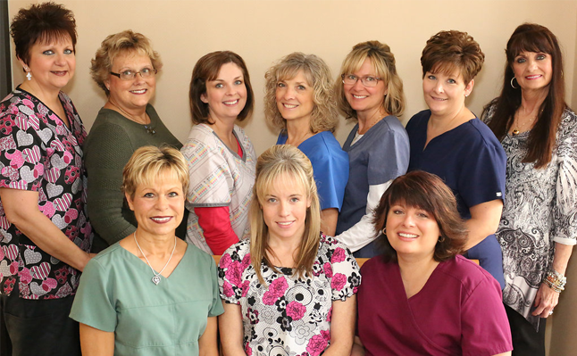

# David L. Porter, D.D.S., P.C. - Meet The Team

- **URL:** https://www.porterfamilydentistry.com/our-practice/meet-the-team/
- **Meta description:** Welcome to our Meet The Team page. Contact Porter Family Dentistry today at (219) 362-5205 or visit our office servicing La Porte, Indiana
- **H1:** (none — page heading is an h2: Meet The Team)
- **Nav:** Our Practice > Meet The Team
- **Words (main content):** 264

## [Page banner]
 banner8.jpg · 1900x350px · alt=""

---

## Meet The Team

 team_group-photo_10-staff.png · 646x399px · alt=""

At the core of our dental practice is a friendly team of professionals that are dedicated to your utmost comfort and optimal oral health. We view each patient as a unique individual, and tailor each treatment to your specific needs. As part of our commitment to providing close, personalized attention to every patient, we want to encourage patient communication. Please know that we are here to provide outstanding patient care, and that we value the trust you have placed in us.

---

 team_dr-david-l-porter_headshot.jpg · 275x385px · alt=""

## Dr. David L. Porter

David L. Porter received his Bachelor's Degree from Wabash College and his Doctor of Dental Science from Indiana University. He is a member of American Dental Association., The Northwest Indiana Dental Association, The Chicago Dental Society, The Better Business Bureau and the La Porte Chamber of Commerce.

Dr. Porter opened his office in 1980 and has always focused on painless dental care and high level of education for his patients while assembling both highly professional and deeply empathetic staff members.

Born and raised in La Porte, Indiana, Dr. Porter is a member of St. Peter’s Church where he is a Eucharistic Minister, teaches Bible studies, and is a former Parish Council Member. He is a member of the La Porte Planning and Zoning Commission.

## Cheryl Grace

### Office Manager

Cheryl has been involved as a dental assistant and office manager for 37 years. For decades she and her dentist husband owned and operated two dental offices in Merrillville, Indiana and Lake of the Four Seasons, Indiana. Cheryl’s generous, upbeat spirit welcomes all our patients with open arms.

---
*Shared site sections also shown on this page (content in `_site.md`): testimonialsCarousel, officeLocation, phoneBar*
