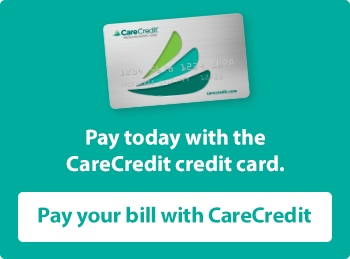

# David L. Porter, D.D.S., P.C. - Financing

- **URL:** https://www.porterfamilydentistry.com/patient-information/financing/
- **Also reached via:** https://www.porterfamilydentistry.com/patient-information/Financing.aspx
- **Meta description:** Welcome to our Financing page. Contact Porter Family Dentistry today at (219) 362-5205 or visit our office servicing La Porte, Indiana
- **H1:** (none — page heading is an h2: Financing)
- **Nav:** Patient Information > Financing
- **Words (main content):** 254

## [Page banner]
 banner4.jpg · 1900x350px · alt=""

---

## Financing *(hidden on load)*

Financing with

 badge_carecredit-logo-tagline.png · 300x123px · alt="care credit"

---

The convenient healthcare financing solution.

 badge_carecredit_apply-now-button.png · 350x213px · alt="" (links to https://www.carecredit.com/go/GCG545/)

[IFRAME embed](https://www.carecredit.com/providercenter/assets/views/resourcescenter/promote/assetlistings/getAsset-calculator.php?size=326x232&color=00ac9d)

 badge_carecredit_pay-bill-button.jpg · 350x259px · alt="" (links to https://www.carecredit.com/Pay/GCG545/)

## CareCredit healthcare credit card for dental procedure financing.

We are pleased to accept the CareCredit healthcare, credit card. CareCredit lets you say "Yes" to recommended surgical and non-surgical dental procedures like crowns, oral surgery or even a general checkup, and pay for them in convenient monthly payments that fit your financial situation.

CareCredit is a credit card that helps you pay for treatments and procedures for you or your family that may not be covered by insurance. With special financing options,\* you can use your CareCredit card again and again for your dental needs, as well as at thousands of other healthcare providers, including optometrists, veterinarians, ophthalmologists and hearing specialists.

It's free and easy to apply and you'll receive a decision immediately. If you're approved, you can schedule your procedures even before you receive your card. With more than 21 million accounts opened since CareCredit began nearly 30 years ago, they are the trusted source for healthcare credit cards.

Learn more by visiting [www.carecredit.com](https://www.carecredit.com/) or contacting our office. Ready to apply? Apply online for your CareCredit healthcare credit card today.

You'll be smiling brighter in no time! [Apply Now](https://www.carecredit.com/go/GCG545/)

\*Subject to credit approval. Minimum monthly payments required. Visit [www.carecredit.com](https://www.carecredit.com/) for details.

Note: Collection of patient information by CareCredit through this CareCredit Services Tab is governed by CareCredit in the CareCredit privacy and data collection practices of CareCredit and are made available to patients by CareCredit and NOT by the privacy policies contained on this Practice’s website.

---
**Embedded media on page:**

- video (other): https://content.prosites.com/images/carecredit/bb_10202017_GEC1806_Dental.mp4 
- iframe (section-carecredit-financing-page): https://www.carecredit.com/providercenter/assets/views/resourcescenter/promote/assetlistings/getAsset-calculator.php?size=326x232&color=00ac9d 

---
*Shared site sections also shown on this page (content in `_site.md`): testimonialsCarousel, officeLocation, phoneBar*
